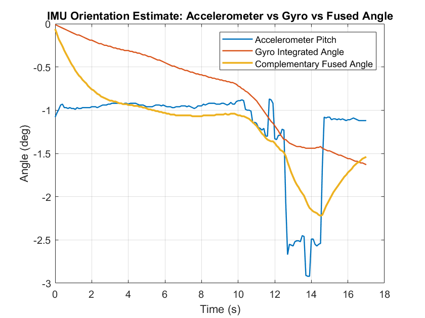
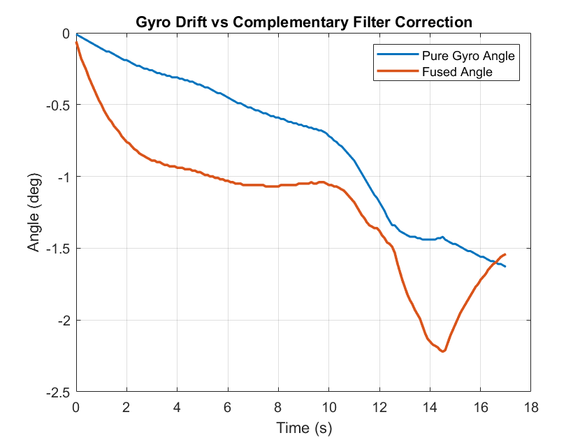

# Project Progress Update – IMU Sensor Fusion and Telemetry System

## Current Status

The project has successfully progressed from basic MPU-6050 communication into a functioning real-time orientation estimation system. Core sensor acquisition, filtering, calibration, and fusion logic have been implemented and validated through both physical testing and telemetry analysis.

## Completed Components

### Sensor Communication

* Established stable I2C communication with the MPU-6050.
* Configured accelerometer and gyroscope operating ranges.
* Implemented structured sensor acquisition architecture.

### Sensor Calibration

* Measured and applied static gyro bias corrections.
* Measured and applied accelerometer bias corrections.
* Investigated multiple stationary datasets to refine calibration values.

### Signal Processing

* Implemented moving-average filtering for:

  * Accelerometer X/Y/Z
  * Gyroscope X/Y/Z
* Reduced high-frequency sensor noise while maintaining usable responsiveness.

### Orientation Estimation

* Developed accelerometer-based pitch estimation using gravity-vector geometry.
* Implemented gyro rate conversion and angular integration.
* Corrected sign conventions and sensor axis orientation.

### Complementary Filter Fusion

* Integrated accelerometer and gyroscope measurements using a complementary filter.
* Tuned filter weighting to balance:

  * Gyro responsiveness
  * Accelerometer stability
* Verified that the fused angle remains stable despite significant gyro drift.

## Validation Testing

Extensive validation testing was performed, including:

### Static Testing

* Long-duration stationary testing.
* Gyro drift characterization.
* Baseline orientation verification.

### Motion Testing

* Forward tilt validation.
* Backward tilt validation.
* Return-to-baseline testing.
* Rapid movement recovery testing.

### Disturbance Testing

* Physical tapping of the sensor.
* Table vibration tests.
* Abrupt motion disturbance tests.

Results demonstrated that:

* Pure gyro integration accumulates drift over time.
* Accelerometer estimates remain stable but noisy.
* The complementary filter successfully constrains drift while preserving responsiveness.

## MATLAB Analysis Pipeline

A telemetry analysis workflow was developed using MATLAB.

Generated figures include:

1. Accelerometer Pitch vs Gyro Angle vs Fused Angle
2. Gyro Drift vs Complementary Filter Correction
3. Raw vs Filtered Accelerometer Data
4. Raw vs Filtered Gyroscope Data
5. Corrected Gyroscope Rate Over Time

These plots provide quantitative validation of system performance and document the effectiveness of the implemented filtering and fusion algorithms.

## Major Engineering Challenges

Throughout development, several challenges were encountered and resolved:

* Gyroscope bias drift
* False orientation estimates ("ghost tilt")
* Gravity vector handling errors
* Sign convention mismatches
* Timing inaccuracies in gyro integration
* Sensor fusion tuning tradeoffs
* Real-world vibration and disturbance effects

These issues required iterative debugging, telemetry analysis, and mathematical verification to resolve.

## Current Project Architecture

MPU-6050 Sensor

→ Calibration Corrections

→ Moving Average Filters

→ Accelerometer Pitch Estimation

→ Gyroscope Rate Integration

→ Complementary Filter Fusion

→ CSV Telemetry Logging

→ MATLAB Analysis & Visualization

## Project Completion Estimate

Current Completion: ~75%

Completed:

* Sensor acquisition
* Calibration
* Filtering
* Sensor fusion
* Validation testing
* Telemetry analysis

Remaining:

* Documentation refinement
* Wireless telemetry migration (ESP32)
* Embedded deployment optimization
* Data logging API architecture
* RC platform integration

## Long-Term Objective

The long-term goal is to build a compact embedded telemetry platform capable of:

* Real-time orientation estimation
* Wireless sensor streaming
* Automated telemetry logging
* Data analysis through a custom logging API
* Deployment on mobile robotic platforms such as RC vehicles

The project has now moved beyond proof-of-concept sensing and into system characterization, telemetry analysis, and deployment preparation.

**Figure 1 – Orientation Estimation During Disturbance Testing**

This figure compares accelerometer-derived pitch, gyroscope-integrated angle, and the complementary-filter orientation estimate during a deliberate disturbance event. Around 12–15 seconds, a rapid motion was introduced to the sensor, causing the accelerometer pitch estimate to experience a significant transient deviation due to linear acceleration effects. The gyroscope estimate remained comparatively smooth but continued to accumulate bias drift throughout the test. The complementary filter successfully combined both measurements, substantially reducing the magnitude of disturbance-induced angle spikes while maintaining a stable orientation estimate. Following the disturbance, the fused angle recovered toward its baseline value, demonstrating the filter's ability to reject transient motion artifacts while preserving long-term orientation stability.

**Figure 2 – Orientation Estimation During Disturbance Testing**

This figure compares accelerometer-derived pitch, gyroscope-integrated angle, and the complementary-filter orientation estimate during a deliberate disturbance event. The accelerometer pitch estimate exhibits significant transient deviations due to rapid motion and linear acceleration, while the gyroscope angle remains comparatively smooth but continues to accumulate drift. The complementary filter successfully combines both measurements, reducing disturbance-induced angle spikes while maintaining recovery to the baseline orientation estimate. These results demonstrate the filter's ability to reject short-duration disturbances without sacrificing long-term stability.

**Figure 3 – Gyroscope Drift Correction Using a Complementary Filter**

This stationary validation test highlights the effects of gyroscope bias drift and the corrective action of the complementary filter. While the pure gyroscope estimate continuously diverges from the initial orientation due to accumulated integration error, the fused angle remains bounded by periodically correcting itself using the accelerometer-based reference. The results confirm that the complementary filter successfully limits long-term drift while preserving the smooth response characteristics of gyroscope measurements, making it suitable for real-time orientation estimation.

